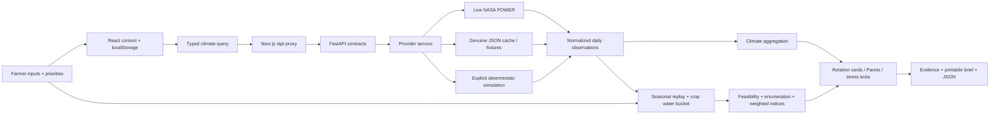

# Architecture

## System boundaries

The map has a separate visual-context path: Natural Earth/Esri/GIBS → MapLibre or SVG. Clicking supplies a coordinate to the central farm state. A pixel color never becomes a scientific measurement. The approximate POWER support cell is explicitly coarse.

## Frontend

`src/app/page.tsx` mounts `TerraProvider` and `Shell`. The App Router supplies the document and metadata; this is a client-interactive workspace with seven views, not seven independent server routes. Navigation state is intentionally held in context. Browser back/deep links do not currently select workspace views.

`src/lib/types.ts` describes frontend contracts. `store.tsx` owns farm input, priorities, date interval, provider, scenario, selected rotation, learning mode and resources. Farm and learning mode persist under `terrashift-v1`. Edits to generated alternatives carry into charts and the brief for this session; changing analysis inputs regenerates strategies.

Requests debounce by 450 ms. AbortController cancels obsolete client requests. Data is cleared on request changes so old values do not look like results for a new location. Climate loading and analysis loading have distinct error paths. The backend can finish a canceled calculation, but the canceled client response cannot replace current state.

Components have focused responsibilities: Shell/navigation, Overview/dashboard, MapExplorer, FarmConfig, RotationStudio, ClimateLab, Charts, Evidence, DecisionBrief and shared UI primitives. Styling is a cohesive CSS design system with responsive breakpoints and print styles. Tailwind was not needed for the implemented component design. Fonts are bundled locally.

## Backend

- `contracts.py`: Pydantic validation, bounds, dates and matching coordinates.
- `providers/power.py`: GeoJSON parsing and unit checks.
- `providers/service.py`: live/cache/simulation selection and data receipts.
- `providers/simulation.py`: deterministic test weather.
- `science/climate.py`: monthly summaries, dry spells, radiation and ET₀.
- `knowledge.py`: explicit crop assumptions and official source catalog.
- `science/rotation.py`: weather replay, daily balance, constraints, exhaustive enumeration, MCDA, frontier, stress and sensitivity.
- `main.py`: thin API layer. CPU calculations run in a worker thread, keeping the async server responsive.

There is no opaque AI service, database dependency, credential manager or field-level inference engine. Python standard library arithmetic is sufficient for the current model; Xarray/GDAL are intentionally deferred until scientific rasters are actually integrated.

## Cache and reproducibility

Live request URLs are hashed into a workspace cache key. Validated raw responses and retrieval timestamps are written atomically. Genuine fixtures can satisfy subsets of their time interval at the same coordinates (0.001° tolerance accommodates returned coordinate rounding). There is no spatial interpolation from a cached neighboring farm.

All normalized daily observations receive a SHA-256 checksum. Reproducibility includes input configuration, source receipt, crop constants and model version. A checksum detects a changed input series; it does not establish source accuracy.

## Extension seams

Implement a new source parser against actual files, normalize explicit units and quality flags, add a provider mode and fixture tests, then expose a separately classified chart. Do not map NDVI directly into nutrient gains or replace root-zone water with surface SMAP moisture. Introduce a physical model only after defining compatible inputs and validation evidence.

For multi-user deployment, add authentication, server-side persistence, bounded job queues, request quotas, cache expiry policy and credential storage. The present application is a local learning system with production-style module boundaries, not a hardened hosted service.
